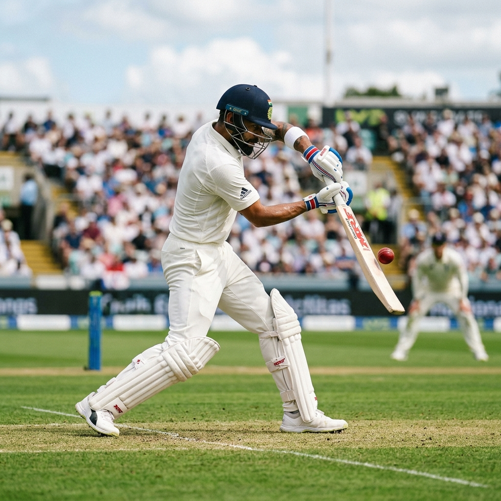

# 🏏 Cricket Shadow Coach

**Real-time AI cricket technique analysis in your browser — score your batting strokes and screen your bowling action against the ICC 15° elbow-extension guideline, using nothing but a webcam.**

🔗 **Live:** https://www.cricketcoach.online



> The live view overlays a real-time skeleton on your camera feed and streams joint
> telemetry as you move. (Add a `docs/skeleton-overlay.gif` here to show it in motion.)

---

## Features

- **5 batting drills** — cover drive, straight drive, pull shot, defensive block, flick shot — each scored against a biomechanically-authored ideal model via Dynamic Time Warping.
- **Guided cover-drive practice** — five usable attempts, one practice cue, then five more with an average-match and score-spread comparison. Progress resumes in the same browser; completed summaries can be downloaded without video or landmarks.
- **Practice progress dashboard** — `/progress` keeps the latest 50 completed guided practices, with a recent-set chart, hand/camera filters, exact scores, past focus cues, and summary downloads. Starting another practice preserves the previous comparison.
- **ICC bowling action screen** — an *indicative* elbow-extension check against the 15° Rule 11.1 guideline, with honest 2D-camera caveats (see [Limitations](#accuracy--limitations)).
- **Hands-free auto-record** — stand in your stance and the app detects stability, counts you down, records the shot, and analyses the follow-through automatically.
- **Live skeleton overlay + telemetry** — real-time joint angles (elbows, knees, spine tilt) with a ghost blueprint to align your stance.
- **Left / right-handed support** — the ideal model mirrors for left-handers.
- **Separate bowling-arm selection** — bowling measures the selected arm independently of your saved batting hand.
- **Runs in-browser** — MediaPipe Pose executes on-device; your video never leaves your machine.
- **Installable PWA** — offline app-shell, add-to-home-screen.

## Architecture

```
┌─────────────────────────── Browser (on-device) ───────────────────────────┐
│                                                                            │
│  Webcam ─▶ MediaPipe Pose ─▶ 2D + 3D world landmarks ─▶ Canvas skeleton    │
│                                    │                                       │
│                                    ▼                                       │
│                       33 joint coords / frame (no video)                   │
└────────────────────────────────────┬───────────────────────────────────────┘
                                      │  POST /api/analyze-shot
                                      ▼
┌──────────────────────────── FastAPI backend ───────────────────────────────┐
│  extract angles ─▶ visibility gate ─▶ smooth ─▶ resample(50) ─▶ DTW vs ideal │
│  ─▶ blend with motion/stance quality ─▶ score + coaching feedback           │
└─────────────────────────────────────────────────────────────────────────────┘
```

**Stack:** React 19 + Vite (frontend, Vercel) · FastAPI (serverless on Vercel, or containerised on Render/Fly) · MediaPipe Pose (in-browser) · fastdtw + NumPy/SciPy scoring.

## Quickstart (local dev)

**Frontend**
```bash
npm install
npm run dev        # http://localhost:5173  (proxies /api to :8000)
```

**Backend**
```bash
cd api
python -m venv .venv && source .venv/bin/activate
pip install -r requirements.txt          # or requirements-full.txt for ball tracking
uvicorn index:app --reload --port 8000
```

**Tests**
```bash
npm test                        # frontend + recording/recovery tests (vitest)
cd api && python -m pytest tests -q
python -m eval.run_eval         # scoring calibration harness
```

## Accuracy & Limitations

The scorer is calibrated with a synthetic eval harness (`api/eval/`). These
checks measure consistency against reference-derived examples, **not accuracy
on independent real players**. Scores are movement comparisons for practice,
not percentages of cricket ability. Current synthetic results:

| Case | Score | Target |
|------|------:|:------:|
| Ideal replay (all 5 shots) | 100 | ≥ 90 |
| Time-stretched ideal (0.5×–2×) | 100 | ≥ 85 |
| Noisy ideal (±3° jitter) | 100 | ≥ 75 |
| Sitting still | 5 | ≤ 30 |
| Random flailing | 7 | ≤ 30 |

Run `python -m eval.run_eval` from `api/` to reproduce.

Practice recordings stop at 15 seconds or 600 tracked frames, whichever comes
first. Analysis requests time out after 30 seconds and can be cancelled. Failed
attempts stay in page memory for an explicit retry, retaining the original drill
and handedness; starting a new recording or leaving the page discards them.
Model loading failures show a retry action and keep recording disabled.
Repeated runtime tracking failures stop recording and offer a model retry;
interrupted partial strokes are not submitted for analysis.

On `/live`, choose your batting hand and camera, then select **Start cover-drive
practice**. The drill and setup controls stay fixed across the two sets. The app
pauses for your focus after the first five; select **Start second set** to continue.
Uncertain tracking, incomplete strokes, and confident matches to another shot do
not count. Lower-scoring strokes with usable tracking still count. Focus cues
come from the phases measured across all five attempts, with a general rhythm cue
when segmentation is incomplete; they still require real-player/coach validation.

Select **Progress** in the app navigation to review completed practices. Records
stay in the same browser, with no account or video upload. Existing completed
sessions are picked up automatically; unfinished sessions stay in guided
practice. Download important summaries before clearing browser data.

The offline app shell excludes the full image library and experimental model.
Images are cached as they are viewed; camera model loading and scoring still
require a connection.

**Bowling legality is an indicative screen, not an official verdict.** A single 2D
camera cannot match lab-grade 3D motion capture: elbow extension is defined in the
arm's plane, but a webcam measures it in the image plane, and perspective
foreshortening can add or remove tens of degrees. The app labels results as
"likely legal / possible throw (indicative)", surfaces a disclaimer, and warns when
you're filmed side-on (where the read is least reliable). Film front-on or at ~45°.

Batting scores also degrade when landmarks aren't well tracked; the response
reports a **tracking-quality** percentage and the UI warns below 60%.

## Deployment

- **Frontend:** Vercel (`vercel.json` — SPA rewrite + `/api/*` → `api/index.py`).
- **Backend (serverless):** Vercel Python function. Ball tracking is disabled here
  (returns 501) since opencv/ultralytics are too large for serverless.
- **Backend (container):** `api/Dockerfile` / `render.yaml` / `api/fly.toml` install
  `requirements-full.txt` and set `ENABLE_BALL_TRACKING=true` so `/api/track-ball` works.

The bowling-action training script (`api/train_action_model.py`) produces a
`bowling_model.pt`; it is a research artifact not used at runtime and is **not**
tracked in git (attach it to a GitHub Release if needed).

## Documentation

- [docs/ARCHITECTURE.md](docs/ARCHITECTURE.md) — system design & algorithms
- [docs/VALIDATION_PLAN.md](docs/VALIDATION_PLAN.md) — real-player evaluation and device acceptance checks
- [docs/PILOT_PROTOCOL.md](docs/PILOT_PROTOCOL.md) — ready-to-run cover-drive pilot and observation form
- [docs/CALCULATION_AUDIT.md](docs/CALCULATION_AUDIT.md) — mathematical corrections, regression cases, and scoring-method version
- [docs/API_REFERENCE.md](docs/API_REFERENCE.md) — endpoint reference
- [docs/DEPLOYMENT.md](docs/DEPLOYMENT.md) — production deployment
- [docs/INDEX.md](docs/INDEX.md) — full docs table of contents

## License

MIT © 2026 Bilal Hasan
